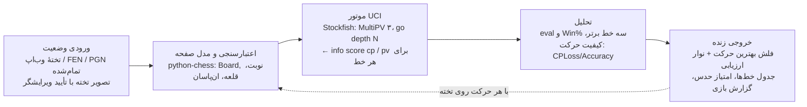

# معماری سیستم تحلیل کیفیت حرکت‌ها — از وضعیت صفحه تا حکم موتور

این سند مراحل پیاده‌سازی یک سیستم تحلیل شطرنج را توضیح می‌دهد: چطور یک
«وضعیت» به دادهٔ قابل‌فهم برای موتور تبدیل می‌شود، موتور چطور با پروتکل UCI
حرف می‌زند، و «کیفیت حرکت» دقیقاً با چه ریاضیاتی سنجیده می‌شود.

> ⚠️ **مرز جوانمردانه — قبل از هر چیز**
>
> نسخه‌ای از این سیستم که صفحهٔ یک **بازی آنلاین در حال انجام** را بخواند و
> بهترین حرکت بعدی را لحظه‌ای پیشنهاد دهد، طبق
> [Chess.com Fair Play Policy](https://www.chess.com/legal/fair-play) و
> قوانین Lichess «کمک گرفتن از موتور حین بازی» و صریحاً **تقلب** است؛
> سایت‌ها آن را با تحلیل آماری دقت حرکت‌ها تشخیص می‌دهند و نتیجه‌اش
> بسته‌شدن حساب است — دقیقاً همان تحلیلی که این پروژه برای بازی‌های
> تمام‌شده انجام می‌دهد!
>
> پس این مخزن هیچ ماژول کپچر خودکار از صفحهٔ سایت‌ها/برنامه‌های دیگر و
> هیچ اتصالی به بازی رقابتی ندارد. تحلیل «زنده» در این پروژه یعنی تحلیل
> لحظه‌ایِ تخته‌ای که **داخل خود برنامه** است، با این حالت‌ها:
>
> 1. **تختهٔ تحلیل زنده** (وب‌اپ): حرکت می‌کنید و موتور همان لحظه بهترین
>    حرکت بعدی و سه خط برتر را با فلش نشان می‌دهد — برای مطالعهٔ عمیق؛
> 2. **حدس بهترین حرکت**: اول شما حدس می‌زنید، بعد موتور امتیاز می‌دهد؛
> 3. **بازی تمرینی مقابل خود موتور** با بازخورد پس از هر حرکت؛
> 4. **تحلیل پس از بازی** روی PGN دانلودشده (`analyze`) و مرور
>    قدم‌به‌قدم آن با تحلیل زندهٔ هر وضعیت؛
> 5. **واردکردن وضعیت از تصویر**: فایلی که خودتان می‌دهید (دیاگرام کتاب،
>    پازل، تصویر یک تختهٔ تمرینی) خوانده می‌شود و پس از تأیید شما در
>    ویرایشگر، روی همان تختهٔ تحلیل زنده می‌نشیند.

## نمای کلی زنجیره



نقشهٔ کد همین زنجیره است:

| ماژول | نقش |
|---|---|
| `chess_player/engine.py` | لایهٔ موتور: Stockfish با UCI و MultiPV + موتور جایگزین آموزشی |
| `chess_player/analysis.py` | ریاضیات کیفیت حرکت، تحلیل زندهٔ چندخطی، امتیاز حدس، تحلیل کل بازی |
| `chess_player/image_fen.py` | خواندن وضعیت از تصویر دستی (سیلوئت + جزئیات داخلی مهره) |
| `chess_player/report.py` | گزارش Markdown / JSON / HTML + نمودار SVG |
| `chess_player/cli.py` | رابط خط فرمان (`analyze` ، `fen` ، `image` ، `serve`) |
| `chess_player/webapp.py` + `static/index.html` | سرور و رابط «استودیو تحلیل زنده» |

## مرحلهٔ ۱ ـ وضعیت از کجا می‌آید؟ (ورودی‌های قانونی)

موتور فقط یک چیز می‌خواهد: **FEN**؛ رشته‌ای مثل
`rnbqkbnr/pppp1ppp/8/4p3/4P3/5N2/PPPP1PPP/RNBQKB1R b KQkq - 1 2`
که جای مهره‌ها، نوبت، حق قلعه و ان‌پاسان را کامل توصیف می‌کند.
هر ورودی در نهایت به FEN می‌رسد:

- **PGN (مسیر اصلی):** بعد از بازی، از Chess.com ‏(Share → Export PGN)
  یا Lichess ‏(⋮ → Download PGN) فایل را می‌گیرید. `python-chess`
  آن را حرکت‌به‌حرکت روی تخته اجرا می‌کند و قبل از هر حرکت یک FEN داریم.
- **FEN دستی:** در تختهٔ تحلیل همان سایت‌ها بعد از بازی می‌توانید FEN هر
  لحظه را کپی کنید؛ برای وضعیت کتاب/پازل هم FEN دستی وارد می‌شود.
- **تختهٔ تمرینی:** در بازی مقابل موتور، تخته داخل خود برنامه است و FEN
  همیشه در دست است (در وب‌اپ، مرورگر FEN فعلی را با هر درخواست می‌فرستد و
  سرور همه‌چیز را دوباره با `python-chess` اعتبارسنجی می‌کند).

### خواندن وضعیت از تصویر — پیاده‌سازی‌شده در `image_fen.py`

ورودی، فایل تصویری‌ای است که کاربر آگاهانه می‌دهد (دیاگرام کتاب، پازل،
تصویر تختهٔ تمرینی). زنجیرهٔ پیاده‌شده:

1. **تعیین محدودهٔ تخته با خود کاربر:** در مرورگر دو گوشهٔ روبه‌روی تخته
   روی تصویر کلیک می‌شود و همان ناحیه به مربع ۸۰۰×۸۰۰ برش می‌خورد.
   (تشخیص خودکار چهارضلعی و تصحیح پرسپکتیو برای عکس‌های مایل از تختهٔ
   فیزیکی کار آینده است؛ برای تصاویر دیجیتال روبه‌رو همین برش کافی و
   قابل‌اعتمادتر از حدس خودکار است.)
2. **برش به ۶۴ خانه** و برای هر خانه: برآورد رنگ پس‌زمینه از میانهٔ چهار
   گوشهٔ خانه و ساخت **ماسک سیلوئت** با فاصلهٔ رنگی از پس‌زمینه؛ خانهٔ با
   اشغال کمتر از ٪۳٫۵ خالی است.
3. **رنگ مهره** از نسبت پیکسل‌های روشن/تیرهٔ داخل سیلوئت.
4. **نوع مهره با تطابق الگوی دوکاناله:** علاوه بر سیلوئت، ماسک
   **جزئیات داخلی** (خطوط تیره در مهرهٔ سفید، روشن در مهرهٔ سیاه) هم با
   الگوها مقایسه می‌شود (`IoU` سیلوئت ×۰٫۵۸ + `IoU` جزئیات ×۰٫۳۲ + نسبت
   ارتفاع ×۰٫۱۰). سیلوئت تنها فیل را با پیاده و وزیر را با اسب قاطی
   می‌کند — صلیب فیل و خطوط تاج وزیر دقیقاً همان جزئیاتی‌اند که کانال
   دوم می‌بیند. الگوها (۱۲ ترکیب نوع×رنگ) از یک فونت شطرنجی ساخته و در
   `piece_templates.npz` ذخیره شده‌اند؛ بازسازی:
   `python -m chess_player.image_fen`
5. **تأیید انسانی:** نتیجه به‌صورت گرید + اطمینان هر خانه برمی‌گردد؛
   خانه‌های کم‌اطمینان در ویرایشگر قرمز می‌شوند و کاربر با پالت مهره‌ها
   اصلاح می‌کند. بعد FEN ساخته و با `board.is_valid()` اعتبارسنجی
   می‌شود و تازه آن وقت تحلیل زنده شروع می‌شود.

دقت: روی رندرهای دیجیتال تمیز (سبک الگوبرداری‌شده) رفت‌وبرگشت
رندر←تشخیص در تست‌ها **۶۴ از ۶۴** است؛ روی ست‌های مهرهٔ دیگر افت می‌کند
و برای همین مرحلهٔ ۵ وجود دارد. مسیر ارتقای تولیدی، یک CNN کوچک
آموزش‌دیده روی رندرهای مصنوعی با ده‌ها ست مهره و تم رنگی است.

نکتهٔ مرزی: این ورودیِ دستی و تک‌وضعیتی است — نه حلقه‌ای که صفحهٔ یک
بازی در جریان را کپچر کند و خودکار فلش حرکت بکشد.

## مرحلهٔ ۲ ـ حرف‌زدن با Stockfish (پروتکل UCI)

Stockfish یک فایل اجرایی جدا است؛ نصبش:

```bash
# Ubuntu/Debian:   sudo apt install stockfish
# macOS:           brew install stockfish
# Windows:         دانلود از stockfishchess.org و گذاشتن مسیر exe در --engine
```

گفتگو روی stdin/stdout با پروتکل UCI انجام می‌شود (کتابخانهٔ
`python-chess` در `engine.py` همین را زیر کاپوت انجام می‌دهد):

```
→ uci
→ position fen rnbqkbnr/... w KQkq - 0 1
→ go depth 14
← info depth 14 score cp 37 pv e2e4 e7e5 g1f3 ...
← bestmove e2e4
```

چند نکتهٔ عملی:

- `score cp` بر حسب **سانتی‌پیاده** است: `+100` یعنی یک پیاده جلوتر؛
  مات اجباری به صورت `score mate 3` می‌آید و ما آن را برای ریاضیات مرحلهٔ ۳
  به عدد بزرگ (۱۰۰۰۰) نگاشت و بعد در ±۱۰۰۰ برش می‌زنیم.
- امتیاز موتور از دید **بازیکنِ نوبت** است؛ هنگام مقایسهٔ «قبل/بعد از
  حرکت من» باید علامت امتیاز «بعد» برگردد (در `analyze_game` همین کار شده).
- عمق، مصالحهٔ سرعت/کیفیت است: برای کل یک بازی عمق ۱۲ تا ۱۸ معقول است؛
  برای یک وضعیت حساس می‌شود عمق ۲۵+ یا محدودیت زمانی گذاشت.
- **تحلیل زندهٔ چندخطی (MultiPV):** با `setoption name MultiPV value 3`
  موتور در یک جستجو سه خط برتر را می‌دهد (`analyse_multipv` در هر دو
  موتور؛ موتور جایگزین برای هر حرکت ریشه جدا جستجو و رتبه‌بندی می‌کند).
  وب‌اپ با هر تغییر FEN این را صدا می‌زند، نتیجه را بر اساس FEN کش
  می‌کند و پاسخ‌های کهنه (وضعیتی که دیگر روی تخته نیست) را دور می‌ریزد —
  این سه نکته با هم حس «زنده» می‌سازند بدون اینکه سرور زیر بار برود.
- **بهینه‌سازی مهم:** ارزیابی «بعد از حرکت N» همان ارزیابی «قبل از حرکت
  N+1» است؛ کد آن را نگه می‌دارد و موتور برای هر حرکت فقط یک بار صدا زده
  می‌شود (نه دو بار).
- اگر Stockfish نصب نباشد، `SimpleEngine` (نگامکس + آلفا-بتا با ارزیابی
  ماتریال) جایگزین می‌شود تا برنامه و تست‌ها همه‌جا اجرا شوند؛ اما برای
  عددهای جدی Stockfish واقعی بگیرید — موتور جایگزین فقط آویزان‌ماندن
  مهره و مات‌های کوتاه را قابل‌اعتماد می‌بیند.

## مرحلهٔ ۳ ـ «کیفیت حرکت» دقیقاً یعنی چه؟

برای هر حرکت انجام‌شده سه عدد داریم: بهترین امتیاز ممکن در آن وضعیت، و
امتیازی که حرکتِ بازی‌شده واقعاً به آن رسيد (از دید حرکت‌کننده). از این‌ها:

1. **CPLoss** = بهترین امتیاز − امتیاز حرکت من (هرگز منفی نمی‌شود)؛
   میانگینش روی بازی می‌شود **ACPL** هر بازیکن.
2. **Win٪** ـ تبدیل امتیاز به «انتظار نتیجه» با مدل لجستیک لیچس، چون
   از دست دادن ۵۰ سانتی‌پیاده در وضعیت برابر خیلی بدتر از از دست دادنش
   در وضعیت ‎+۶‎ است:

   ```
   Win% = 50 + 50 * ( 2 / (1 + exp(-0.00368208 * cp)) - 1 )     (cp در ±1000 برش‌خورده)
   ```

3. **Accuracy هر حرکت** از افت Win٪:

   ```
   Accuracy = 103.1668 * exp(-0.04354 * (Win%_قبل - Win%_بعد)) - 3.1669
   ```

4. **برچسب حرکت** از روی افت Win٪ (همان منطق Game Review):

   | شرط | برچسب |
   |---|---|
   | حرکت خود موتور | بهترین |
   | افت Win% ≤ ‏۲ | عالی |
   | ≤ ‏۵ | خوب |
   | ≤ ‏۱۰ | عدم دقت ؟! |
   | ≤ ‏۲۰ | اشتباه ؟ |
   | بیشتر | اشتباه فاحش ؟؟ |

دقت کل هر بازیکن = میانگین Accuracy حرکت‌هایش؛ عددی که با آن می‌توانید
سطح خودتان را بازی‌به‌بازی ردیابی کنید و ببینید اشتباه‌هایتان در کدام فاز
اتفاق می‌افتد (با فیلترکردن خروجی JSON روی شمارهٔ حرکت/رنگ).

## مرحلهٔ ۴ ـ خروجی زنده و بازخورد

- **استودیو وب (`serve`):** هر تغییر وضعیت روی تختهٔ خود برنامه →
  `POST /api/live_analyze` → به‌روزرسانی نوار ارزیابی، فلش‌های سه خط و
  جدول خط‌ها (حرکت، ارزیابی، Win٪ سفید، ادامهٔ اصلی). APIهای کلیدی:
  `/api/board_state` و `/api/apply_move` (اعمال قانونی حرکت برای هر
  رنگ)، `/api/live_analyze` (MultiPV)، `/api/guess` (امتیاز حدس)،
  `/api/move` (بازی با موتور)، `/api/load_pgn` (وضعیت‌های یک بازی برای
  مرور)، `/api/analyze_pgn` (گزارش کامل)، `/api/fen_from_image` و
  `/api/fen_from_grid` (واردکردن تصویر و تأیید آن).
- سه ریتم بازخورد برای سه هدف یادگیری: در **تحلیل زنده** پاسخ موتور
  همیشه جلوی چشم است (مطالعه)؛ در **بازی با موتور** بعد از حرکت شما
  می‌آید (تصمیم زیر فشار)؛ در **حدس حرکت** تا وقتی حدس نزده‌اید پنهان
  می‌ماند و بعد رتبه/دقت می‌گیرید (تمرین فعال — مؤثرترین حالت برای
  یادگیری عمیق، چون اول خودتان نامزدها را می‌سازید).
- **CLI:** گزارش Markdown برای خواندن، JSON برای پردازش بعدی (مثلاً رسم
  روند دقت در چند بازی)، HTML مستقل با نمودار ارزیابی SVG؛ و دستور
  `image` برای خواندن وضعیت از فایل تصویر با نمایش خانه‌های کم‌اطمینان.
- برای هر لحظهٔ حساس در گزارش بازی، FEN قبل از حرکت ذخیره می‌شود تا
  همان وضعیت را بعداً در حالت حدس حرکت مثل پازل دوباره تمرین کنید.

## نقشهٔ راه (همه در قلمرو تمرین قانونی)

- [x] ماژول تصویر→FEN برای تصاویر دستی (برش با گوشه‌های انتخابی کاربر،
  تطابق الگوی دوکاناله، ویرایشگر تأیید)
- [x] تختهٔ تحلیل زنده با MultiPV و فلش بهترین حرکت + حالت حدس حرکت
- [ ] ارتقای خواندن تصویر: تشخیص خودکار چهارگوشه و تصحیح پرسپکتیو، و
  CNN کوچک آموزش‌دیده روی رندرهای چندستِ مصنوعی
- [ ] برچسب گشایش (ECO) و نمایش «خروج از تئوری» در گزارش
- [ ] ردیابی روند دقت روی چند بازی (ورودی چند PGN و نمودار پیشرفت)
- [ ] ساخت پازل خودکار از اشتباه‌ها/اشتباه‌های فاحش خودتان (Spaced repetition)
- [ ] درجه‌بندی سختی حریف تمرینی با محدودکردن قدرت Stockfish (Skill Level / UCI_LimitStrength)
