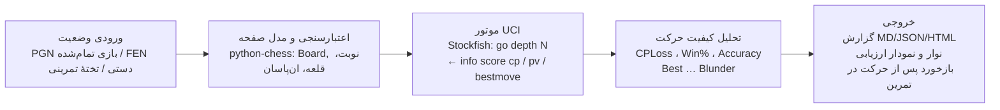

# معماری سیستم تحلیل کیفیت حرکت‌ها — از وضعیت صفحه تا حکم موتور

این سند مراحل پیاده‌سازی یک سیستم تحلیل شطرنج را توضیح می‌دهد: چطور یک
«وضعیت» به دادهٔ قابل‌فهم برای موتور تبدیل می‌شود، موتور چطور با پروتکل UCI
حرف می‌زند، و «کیفیت حرکت» دقیقاً با چه ریاضیاتی سنجیده می‌شود.

> ⚠️ **مرز جوانمردانه — قبل از هر چیز**
>
> نسخه‌ای از این سیستم که صفحهٔ یک **بازی آنلاین در حال انجام** را بخواند و
> بهترین حرکت بعدی را لحظه‌ای پیشنهاد دهد، طبق
> [Chess.com Fair Play Policy](https://www.chess.com/legal/fair-play) و
> قوانین Lichess «کمک گرفتن از موتور حین بازی» و صریحاً **تقلب** است؛
> سایت‌ها آن را با تحلیل آماری دقت حرکت‌ها تشخیص می‌دهند و نتیجه‌اش
> بسته‌شدن حساب است — دقیقاً همان تحلیلی که این پروژه برای بازی‌های
> تمام‌شده انجام می‌دهد!
>
> پس این مخزن عمداً هیچ ماژول اسکرین‌کپچر زنده یا اتصالی به سایت‌های بازی
> ندارد. همان زنجیرهٔ فنی، در سه حالت **قانونی و مفید** پیاده شده است:
>
> 1. **تحلیل پس از بازی** روی PGN دانلودشده (`analyze`)؛
> 2. **تختهٔ تحلیل** روی وضعیتی که خودتان با FEN وارد می‌کنید (`fen`) ـ
>    برای پازل، کتاب و بازبینی بازی تمام‌شده؛
> 3. **تمرین آفلاین مقابل موتور** (وب‌اپ) که در آن اول حرکت می‌کنید و
>    *بعد* بازخورد می‌گیرید.

## نمای کلی زنجیره



نقشهٔ کد همین زنجیره است:

| ماژول | نقش |
|---|---|
| `chess_player/engine.py` | لایهٔ موتور: Stockfish با UCI + موتور جایگزین آموزشی |
| `chess_player/analysis.py` | ریاضیات کیفیت حرکت و تحلیل کل بازی |
| `chess_player/report.py` | گزارش Markdown / JSON / HTML + نمودار SVG |
| `chess_player/cli.py` | رابط خط فرمان (`analyze` ، `fen` ، `serve`) |
| `chess_player/webapp.py` | وب‌اپ تمرین آفلاین + تحلیل در مرورگر |

## مرحلهٔ ۱ ـ وضعیت از کجا می‌آید؟ (ورودی‌های قانونی)

موتور فقط یک چیز می‌خواهد: **FEN**؛ رشته‌ای مثل
`rnbqkbnr/pppp1ppp/8/4p3/4P3/5N2/PPPP1PPP/RNBQKB1R b KQkq - 1 2`
که جای مهره‌ها، نوبت، حق قلعه و ان‌پاسان را کامل توصیف می‌کند.
هر ورودی در نهایت به FEN می‌رسد:

- **PGN (مسیر اصلی):** بعد از بازی، از Chess.com ‏(Share → Export PGN)
  یا Lichess ‏(⋮ → Download PGN) فایل را می‌گیرید. `python-chess`
  آن را حرکت‌به‌حرکت روی تخته اجرا می‌کند و قبل از هر حرکت یک FEN داریم.
- **FEN دستی:** در تختهٔ تحلیل همان سایت‌ها بعد از بازی می‌توانید FEN هر
  لحظه را کپی کنید؛ برای وضعیت کتاب/پازل هم FEN دستی وارد می‌شود.
- **تختهٔ تمرینی:** در بازی مقابل موتور، تخته داخل خود برنامه است و FEN
  همیشه در دست است (در وب‌اپ، مرورگر FEN فعلی را با هر درخواست می‌فرستد و
  سرور همه‌چیز را دوباره با `python-chess` اعتبارسنجی می‌کند).

### دربارهٔ «خواندن صفحه از روی تصویر» چه می‌شود؟

تبدیل **تصویر ذخیره‌شده** (دیاگرام کتاب، اسکرین‌شات یک پازل یا بازی
تمام‌شده) به FEN یک مسئلهٔ کلاسیک بینایی ماشین و پروژهٔ آموزشی خوبی است.
زنجیرهٔ استانداردش این است:

1. **یافتن تخته:** تشخیص بزرگ‌ترین چهارضلعیِ شبکه‌دار
   (آستانه‌گذاری + `findContours` یا خطوط Hough در OpenCV)؛
2. **تصحیح پرسپکتیو:** `warpPerspective` برای تبدیل تخته به مربع روبه‌رو
   و برش آن به ۶۴ خانه؛
3. **طبقه‌بندی هر خانه:** خالی / یکی از ۱۲ نوع مهره — با تطابق الگو
   (template matching) برای یک فونت ثابت، یا یک CNN کوچک آموزش‌دیده روی
   رندرهای مصنوعی تخته برای حالت عمومی؛
4. **مونتاژ و اعتبارسنجی FEN:** ساخت رشته از روی گرید و ردکردن وضعیت‌های
   غیرقانونی با `board.is_valid()` (دقیقاً یک شاه از هر رنگ، پیاده نه در
   ردیف ۱/۸، نوبتِ سازگار با کیش و …)؛ موارد مبهم را کاربر روی تختهٔ
   ویرایش تأیید/اصلاح می‌کند.

این ماژول در نقشهٔ راه (پایین) هست، اما در شکل **ورودی از فایل تصویری که
کاربر آگاهانه برای مطالعه می‌دهد** — نه حلقه‌ای که هر ثانیه صفحهٔ بازی
زنده را اسکرین‌شات بگیرد و رویش فلش «بهترین حرکت» بکشد. آن دومی همان
ابزار تقلب است و در این پروژه ساخته نمی‌شود.

## مرحلهٔ ۲ ـ حرف‌زدن با Stockfish (پروتکل UCI)

Stockfish یک فایل اجرایی جدا است؛ نصبش:

```bash
# Ubuntu/Debian:   sudo apt install stockfish
# macOS:           brew install stockfish
# Windows:         دانلود از stockfishchess.org و گذاشتن مسیر exe در --engine
```

گفتگو روی stdin/stdout با پروتکل UCI انجام می‌شود (کتابخانهٔ
`python-chess` در `engine.py` همین را زیر کاپوت انجام می‌دهد):

```
→ uci
→ position fen rnbqkbnr/... w KQkq - 0 1
→ go depth 14
← info depth 14 score cp 37 pv e2e4 e7e5 g1f3 ...
← bestmove e2e4
```

چند نکتهٔ عملی:

- `score cp` بر حسب **سانتی‌پیاده** است: `+100` یعنی یک پیاده جلوتر؛
  مات اجباری به صورت `score mate 3` می‌آید و ما آن را برای ریاضیات مرحلهٔ ۳
  به عدد بزرگ (۱۰۰۰۰) نگاشت و بعد در ±۱۰۰۰ برش می‌زنیم.
- امتیاز موتور از دید **بازیکنِ نوبت** است؛ هنگام مقایسهٔ «قبل/بعد از
  حرکت من» باید علامت امتیاز «بعد» برگردد (در `analyze_game` همین کار شده).
- عمق، مصالحهٔ سرعت/کیفیت است: برای کل یک بازی عمق ۱۲ تا ۱۸ معقول است؛
  برای یک وضعیت حساس می‌شود عمق ۲۵+ یا محدودیت زمانی گذاشت.
- **بهینه‌سازی مهم:** ارزیابی «بعد از حرکت N» همان ارزیابی «قبل از حرکت
  N+1» است؛ کد آن را نگه می‌دارد و موتور برای هر حرکت فقط یک بار صدا زده
  می‌شود (نه دو بار).
- اگر Stockfish نصب نباشد، `SimpleEngine` (نگامکس + آلفا-بتا با ارزیابی
  ماتریال) جایگزین می‌شود تا برنامه و تست‌ها همه‌جا اجرا شوند؛ اما برای
  عددهای جدی Stockfish واقعی بگیرید — موتور جایگزین فقط آویزان‌ماندن
  مهره و مات‌های کوتاه را قابل‌اعتماد می‌بیند.

## مرحلهٔ ۳ ـ «کیفیت حرکت» دقیقاً یعنی چه؟

برای هر حرکت انجام‌شده سه عدد داریم: بهترین امتیاز ممکن در آن وضعیت، و
امتیازی که حرکتِ بازی‌شده واقعاً به آن رسيد (از دید حرکت‌کننده). از این‌ها:

1. **CPLoss** = بهترین امتیاز − امتیاز حرکت من (هرگز منفی نمی‌شود)؛
   میانگینش روی بازی می‌شود **ACPL** هر بازیکن.
2. **Win٪** ـ تبدیل امتیاز به «انتظار نتیجه» با مدل لجستیک لیچس، چون
   از دست دادن ۵۰ سانتی‌پیاده در وضعیت برابر خیلی بدتر از از دست دادنش
   در وضعیت ‎+۶‎ است:

   ```
   Win% = 50 + 50 * ( 2 / (1 + exp(-0.00368208 * cp)) - 1 )     (cp در ±1000 برش‌خورده)
   ```

3. **Accuracy هر حرکت** از افت Win٪:

   ```
   Accuracy = 103.1668 * exp(-0.04354 * (Win%_قبل - Win%_بعد)) - 3.1669
   ```

4. **برچسب حرکت** از روی افت Win٪ (همان منطق Game Review):

   | شرط | برچسب |
   |---|---|
   | حرکت خود موتور | بهترین |
   | افت Win% ≤ ‏۲ | عالی |
   | ≤ ‏۵ | خوب |
   | ≤ ‏۱۰ | عدم دقت ؟! |
   | ≤ ‏۲۰ | اشتباه ؟ |
   | بیشتر | اشتباه فاحش ؟؟ |

دقت کل هر بازیکن = میانگین Accuracy حرکت‌هایش؛ عددی که با آن می‌توانید
سطح خودتان را بازی‌به‌بازی ردیابی کنید و ببینید اشتباه‌هایتان در کدام فاز
اتفاق می‌افتد (با فیلترکردن خروجی JSON روی شمارهٔ حرکت/رنگ).

## مرحلهٔ ۴ ـ خروجی و بازخورد

- **CLI:** گزارش Markdown برای خواندن، JSON برای پردازش بعدی (مثلاً رسم
  روند دقت در چند بازی)، HTML مستقل با نمودار ارزیابی SVG.
- **وب‌اپ تمرینی:** نوار ارزیابی زندهٔ بازیِ خودتان مقابل موتور و بازخورد
  *پس از* انجام هر حرکت شما («حرکتت عدم دقت بود؛ موتور Nf3 را ترجیح
  می‌داد»). ترتیب «اول تصمیم، بعد بازخورد» عمدی است: مغز شما تصمیم‌گیر
  می‌ماند و موتور نقش مربی پس از حرکت را دارد.
- برای هر لحظهٔ حساس، FEN قبل از حرکت در گزارش ذخیره می‌شود تا همان وضعیت
  را بعداً مثل پازل دوباره تمرین کنید.

## نقشهٔ راه (همه در قلمرو تمرین قانونی)

- [ ] ماژول تصویر→FEN برای دیاگرام‌های ذخیره‌شده (مرحلهٔ ۱) با تأیید دستی کاربر
- [ ] برچسب گشایش (ECO) و نمایش «خروج از تئوری» در گزارش
- [ ] ردیابی روند دقت روی چند بازی (ورودی چند PGN و نمودار پیشرفت)
- [ ] ساخت پازل خودکار از اشتباه‌ها/اشتباه‌های فاحش خودتان (Spaced repetition)
- [ ] درجه‌بندی سختی حریف تمرینی با محدودکردن قدرت Stockfish (Skill Level / UCI_LimitStrength)
